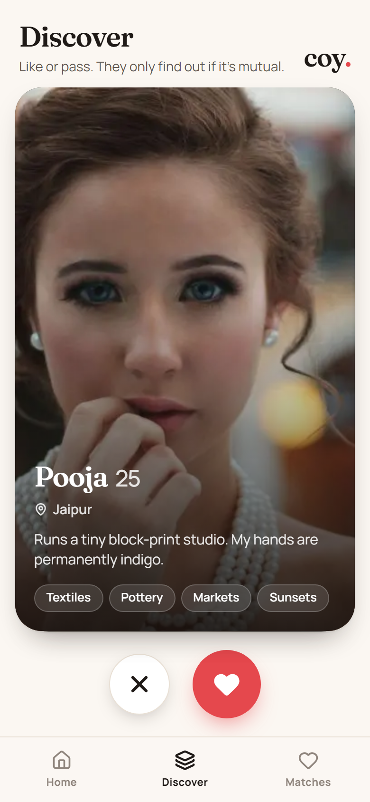
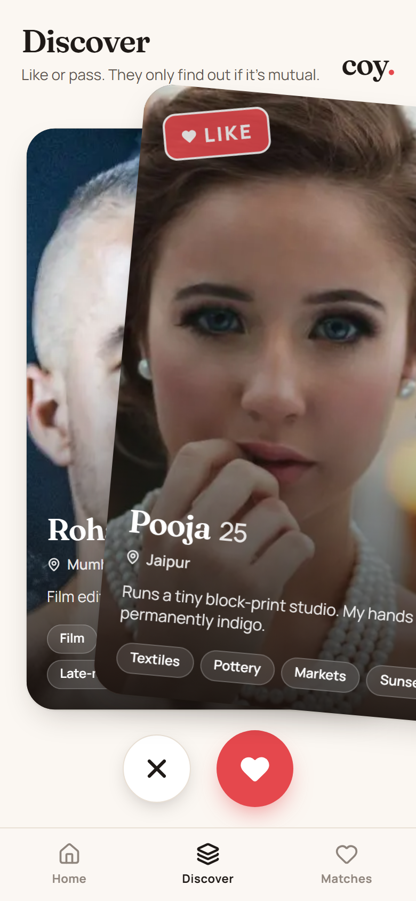
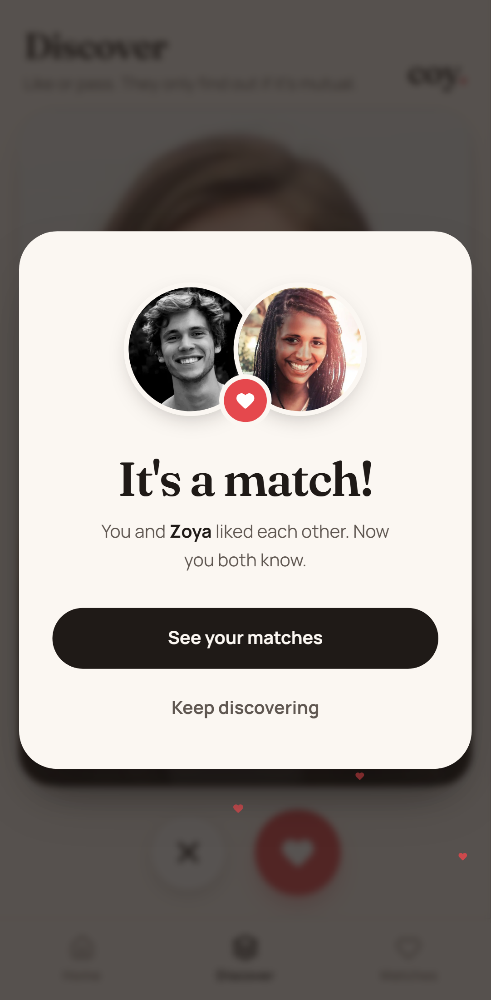
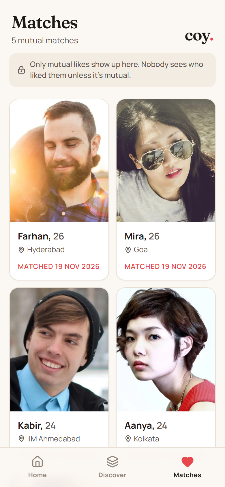
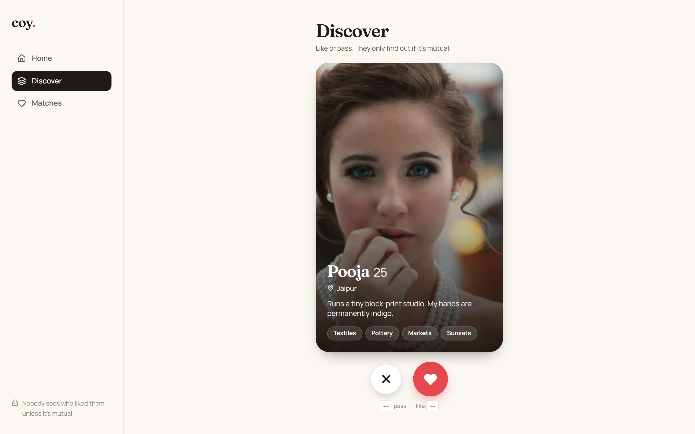

# Coy Discover

A swipe-based **Discover** tab for [Coy](https://getcoy.com), the crush app where nobody finds out who liked them unless it's mutual. Built for the Coy SDE intern assignment ([brief](docs/assignment.md)).

<p>
  
  
  
  
</p>


## Features
- **Discover**: one profile at a time (photo, name, age, city or college, bio, interests). Drag right to like and left to pass, with mouse or touch. The card tilts with the drag, shows LIKE/PASS stamps, and springs back below the threshold. There are buttons on every screen size and ← / → keys on desktop.
- **Feedback**: smooth exit animations, a "Liked Pooja" / "Passed on Rohan" confirmation (also announced to screen readers), and reduced-motion support.
- **Matching**: a match only happens on a mutual like, and the "It's a match!" overlay shows both photos. **Matches** lists every mutual match with its date.
- **Never shows a profile twice**: swiped profiles are excluded on the server, so this survives reloads.
- **Privacy enforced on the server**: no API exposes incoming likes, the feed order doesn't depend on who liked you, and swipe responses have the same shape either way. See [Privacy model](docs/ARCHITECTURE.md#privacy-model).
- **Robust**: optimistic swipes with rollback on failure, double-submit protection, a transactional swipe and match, idempotent retries, and safe duplicate and concurrent requests.
- Empty, loading and error states. Mobile-first, with a centred desktop layout and a side rail.

## Tech stack
Next.js 15 (App Router, Route Handlers) · React 19 · TypeScript · Tailwind CSS 4 · Framer Motion · Prisma 6 + SQLite · Zod · Vitest + Testing Library · Playwright

## Quick start
Requires Node 20+.
```bash
git clone <this repo> && cd coy-discover
npm install                 # also runs `prisma generate`
cp .env.example .env        # DATABASE_URL="file:./dev.db"
npm run setup               # apply migrations + seed demo data
npm run dev                 # http://localhost:3000
```
Open **Discover**. To see a match quickly, pass the first five profiles and **like Zoya** (6th), who has already liked the demo user. 8 seeded profiles have liked the demo user: meera, zoya, naina, aanya, diya, kabir, mira, farhan. To start over, run `npm run db:seed`.

## Scripts
| Command | What it does |
|---|---|
| `npm run dev` / `build` / `start` | Develop / production build / serve the build |
| `npm run setup` | `prisma migrate deploy` + seed |
| `npm run db:seed` | Wipe and reseed the demo data (deterministic) |
| `npm test` | Vitest: unit + API integration (real SQLite test DB) + component tests |
| `npm run test:e2e` | Playwright: the full user journey on desktop and mobile (builds and starts the app on port 3200 with its own DB). First run `npx playwright install chromium` |
| `npm run typecheck` / `lint` | `tsc --noEmit` / ESLint |

## Environment
| Variable | Example | Notes |
|---|---|---|
| `DATABASE_URL` | `file:./dev.db` | SQLite path relative to `prisma/schema.prisma`. Use a Postgres URL in production |

## API
| Method | Path | Returns |
|---|---|---|
| GET | `/api/feed` | Profiles not yet swiped on |
| POST | `/api/swipe` | `{profileId, action: "LIKE" \| "PASS"}` → `201 {swipe, match \| null}` (200 on an identical retry) |
| GET | `/api/matches` | Mutual matches |
| GET | `/api/health` | Liveness and database check |

Full reference with error codes: [docs/API.md](docs/API.md).

## Project docs
- [Architecture & privacy model](docs/ARCHITECTURE.md) · [Database](docs/DATABASE.md) · [API](docs/API.md) · [Testing](docs/TESTING.md)
- [Part A: product analysis & two feature proposals](docs/COY_PRODUCT_ANALYSIS.md)
- [Project status](docs/PROJECT_STATUS.md) · [Development log](docs/DEVELOPMENT_LOG.md) · [Handoff](docs/HANDOFF.md)

## Deployment
The app is a standard Next.js server. SQLite files don't persist on serverless hosts, so for a hosted demo:
1. Create a Postgres database (e.g. Neon) and switch the Prisma provider ([steps](docs/DATABASE.md#switching-to-postgresql-for-hosting)).
2. On Vercel, import the repo, set `DATABASE_URL`, and set the build command to `prisma migrate deploy && next build`.
3. Seed once: `DATABASE_URL=… npm run db:seed`.
Alternatively, any Node host with a persistent disk (Render, Railway, Fly.io volume) can run it with SQLite unchanged: `npm run setup && npm run build && npm start`.

No live deployment has been made yet (see [Project status](docs/PROJECT_STATUS.md)).

## Credits
Portrait photos come from [pravatar.cc](https://pravatar.cc), which serves Unsplash-licensed images. Names, bios and other profile details are fictional.
